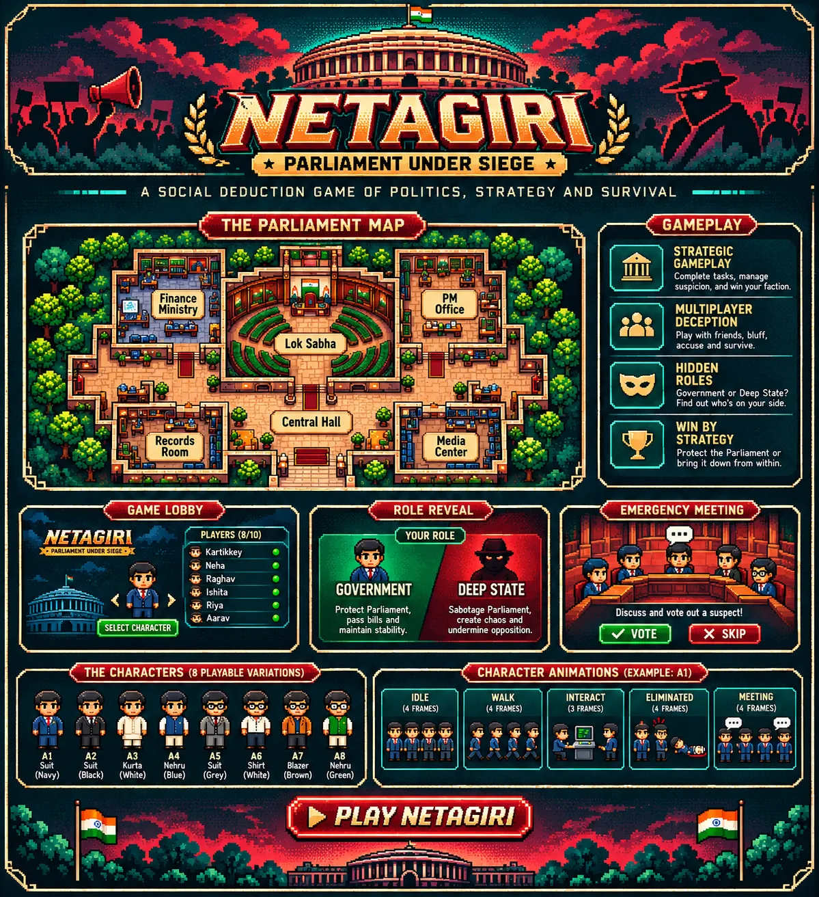

# NETAGIRI — Parliament Under Siege



> Power is temporary. Betrayal is permanent.

A 6–10 player multiplayer social-deduction browser game set in a fictional
Indian Parliament. Government MPs complete parliamentary tasks and vote out
infiltrators; undercover Deep State agents sabotage, eliminate and manipulate
emergency votes.

Current build (placeholder art):


Visual target: see [`docs/references/`](docs/references/README.md).

## Quick start

Needs Node 22 and Python 3.11+.

```bash
python3 -m venv .venv && source .venv/bin/activate
npm run setup                       # root + frontend npm packages, local Python packages
cp backend/.env.example backend/.env
cp frontend/.env.example frontend/.env
npm run dev                         # backend http://localhost:8001 · frontend http://localhost:3000
```

Open http://localhost:3000, create a room, then either join from 5 more browser
windows with the 5-letter code or invite link, or press **Fill seats with bots**
to play solo.

To play from phones on the same Wi-Fi, open `http://<your-computer's-LAN-IP>:3000`.
The frontend forwards `/api` to the backend, so only port 3000 needs to be reachable.

| Command | What it does |
|---|---|
| `npm run dev` | Backend (uvicorn, auto-reload) + frontend (Vite) together |
| `npm run dev:backend` / `npm run dev:frontend` | Just one of them |
| `npm run typecheck` | Frontend `tsc` |
| `npm run build` | Production frontend build → `frontend/build` |
| `npm run test:backend` | pytest suites (10 tests, ~4 min). Needs the backend running |
| `npm run test:e2e` | Spec §13 acceptance pass with 6 browsers (~4 min). Needs `npm run dev` running |

The e2e scripts use the `playwright` version pinned in the root
`package.json`. If its browser isn't installed, run `npx playwright install chromium`,
or point `PLAYWRIGHT_CHROME_EXECUTABLE_PATH` at an existing Chromium.

`backend/requirements.txt` is the Emergent deployment environment and pulls
packages from a private host. For local use, `npm run setup` installs
`backend/requirements-local.txt` instead.

## Controls

| Key | Action |
|---|---|
| WASD / Arrows | Move |
| E | Interact (task / power panel; Deep State: sabotage at the panel) |
| Space / R | Report nearby body |
| Q | Eliminate (Deep State) |
| Esc | Close task panel |

## Repository layout

```
backend/  authoritative Python (FastAPI + python-socketio) game server, in-memory state
frontend/ React + Redux Toolkit client; src/shared holds types, contracts, settings, map
docs/     specs (rules), references/ (visual boards, sprite sheet, key art), PROJECT_PLAN.md, screenshots
e2e/      Playwright multi-browser scripts
plan/, memory/, test_reports/, .emergent/   files written by the Emergent agent
```

See [`docs/TECHNICAL_DOCUMENTATION.md`](docs/TECHNICAL_DOCUMENTATION.md) for how the app is built,
[`CLAUDE.md`](CLAUDE.md) for architecture rules and
[`docs/PROJECT_PLAN.md`](docs/PROJECT_PLAN.md) for the module breakdown and
the step-by-step build prompts.

## Status

| Phase | Status |
|---|---|
| 1. Lobby, room codes, private roles | ✅ done, e2e-verified with 6 clients |
| 2. Parliament map, movement, collision, sync | ✅ done (placeholder art) |
| 3. Tasks + shared progress | ✅ done (12 stations) |
| 4. Mini-games (File Sort, Restore Power, Approve the Bill; HOLD fallback) | ✅ done |
| 5. Elimination + Power Cut | ✅ done |
| 6. Report → meeting → chat → vote | ✅ done |
| 7. Victory, disconnects, game over | ✅ done |
| 8. Results reveal | ✅ done |
| 9. Polish: news, sound, code-drawn sprites + tiles | ✅ done |
| 10. Acceptance pass | see `e2e/acceptance.cjs` output |

Added beyond the original spec (PR #1): bots that fill empty seats, Document
Leak sabotage, camera follow, meeting replay, end-of-game badges, ghost chat,
invite link + QR code, kick, rejoin and play again.
