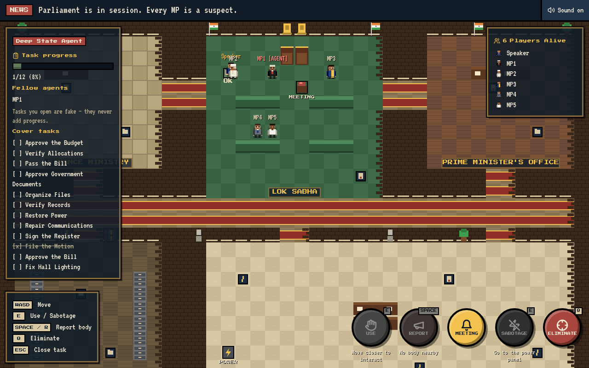

# NETAGIRI — Parliament Under Siege


> Power is temporary. Betrayal is permanent.

A 6–10 player multiplayer social-deduction browser game set in a fictional
Indian Parliament. Government MPs complete parliamentary tasks and vote out
infiltrators; undercover Deep State agents sabotage, eliminate and manipulate
emergency votes.

Current build (placeholder art):



Visual target: see [`docs/references/`](docs/references/README.md).

## Quick start

```bash
nvm use            # Node 22
npm install
npm run dev        # server http://localhost:8001 (socket path /api/socket.io) · client http://localhost:5173
# Emergent preview: supervisor runs `frontend/` → `npm run preview:emergent` (client :3000, server :8001)
```

Open the client in 6+ browser windows (or devices on your LAN — the client
proxies `/api` to the server via `VITE_PROXY_TARGET` in `client/.env`; set `CLIENT_ORIGIN` in `server/.env`), create
a room in one, join with the 5-letter code in the others, and start.

| Command | What it does |
|---|---|
| `npm run dev` | Server (tsx watch) + client (Vite) together |
| `npm test` | Vitest — shared rules + server match logic |
| `npm run typecheck` | `tsc` across shared, server, client |
| `npm run build` | Production client build → `client/dist` |
| `node e2e/smoke.cjs` | 6-browser Playwright smoke (lobby → roles → movement); needs `npm run dev` |
| `node e2e/acceptance.cjs [url]` | Spec §13 acceptance pass with 6 browsers (~4 min, default http://localhost:3000) |

## Controls

| Key | Action |
|---|---|
| WASD / Arrows | Move |
| E | Interact (task / power panel; Deep State: sabotage at the panel) |
| Space / R | Report nearby body |
| Q | Eliminate (Deep State) |
| Esc | Close task panel |

## Repository layout

```
shared/   types, Socket.IO event contracts, settings, pure rules, Parliament map
server/   authoritative Socket.IO game server
client/   React + Redux Toolkit client (mecord folder structure)
docs/     specs (rules), references/ (visual boards, sprite sheet, key art), PROJECT_PLAN.md, screenshots
e2e/      multi-client smoke test
```

See [`CLAUDE.md`](CLAUDE.md) for architecture rules and
[`docs/PROJECT_PLAN.md`](docs/PROJECT_PLAN.md) for the module breakdown and
the step-by-step build prompts.

## Status

| Phase | Status |
|---|---|
| 1. Lobby, room codes, private roles | ✅ done, e2e-verified with 6 clients |
| 2. Parliament map, movement, collision, sync | ✅ done (placeholder art) |
| 3. Tasks + shared progress | ✅ done (12 stations) |
| 4. Mini-games (File Sort, Restore Power, Approve the Bill; HOLD fallback) | ✅ done |
| 5. Elimination + Power Cut | ✅ done |
| 6. Report → meeting → chat → vote | ✅ done |
| 7. Victory, disconnects, game over | ✅ done |
| 8. Results reveal | ✅ done |
| 9. Polish: news, sound, code-drawn sprites + tiles | ✅ done |
| 10. Acceptance pass | see `e2e/acceptance.cjs` output |
