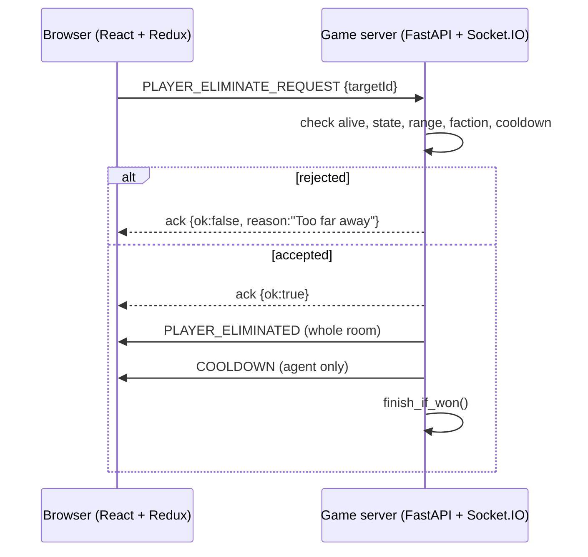
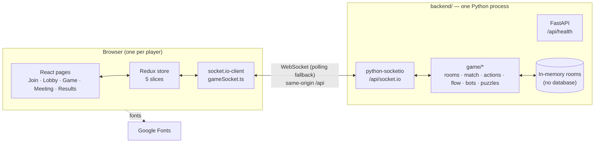

# NETAGIRI: Parliament Under Siege · Technical Documentation

Describes the code on branch `claude/charming-dirac-32et9z` as of November 2026.
Rules come from `docs/specs/gameplay-spec.txt` and visuals from
`docs/references/README.md`. Coding conventions are in `CLAUDE.md`.

---

## 1. Overview

NETAGIRI is a real-time multiplayer social-deduction game that runs in the
browser. It is set in a fictional Indian Parliament and drawn in a 16-bit,
top-down pixel-art style. Each match has 6–10 players, who are secretly
**Government MPs** or **Deep State agents**.

**Core features**

- **Rooms:** join with a 5-letter room code, an invite link or a QR code. The host starts the match.
- **Private roles:** the role split depends on the player count (6 → 4/2 … 10 → 7/3). Agents see their teammates.
- **Map:** one Parliament map with 5 rooms (Lok Sabha, PM Office, Finance Ministry, Records Room, Central Hall). Movement is keyboard-driven, with wall collision and a camera that follows the player.
- **Tasks:** 12 task stations, each a mini-game (File Sort, Restore Power, Approve the Bill, or a hold-to-complete fallback). All tasks feed one shared progress bar.
- **Deep State actions:** eliminate a nearby MP (25s cooldown and a 12s grace period at the start). Sabotage with Power Cut (15s) or Document Leak (20s), which share a 30s cooldown.
- **Meetings:** report a body or press the emergency button. Each meeting runs discussion (40s) → voting (20s, with Skip) → results (4s). Body-report meetings open with a replay of nearby movement.
- **Win conditions:** Government wins with 100% tasks or when every agent is voted out. Deep State wins when living agents ≥ living MPs.
- **Results:** a winner banner, a full role reveal, per-player stats and achievement badges. Every player gets Play again.
- **Added beyond the original spec (PR #1):** bots that fill empty seats, ghost chat for eliminated players, kick, rejoin within 30s after a dropped connection, a breaking-news ticker and code-generated sound effects.

---

## 2. System design

### End-to-end flow

1. **Join.** The browser opens a Socket.IO connection to `/api/socket.io`. It sends `CREATE_ROOM` or `JOIN_ROOM`. The server answers with `{roomCode, playerId, rejoinToken}` and broadcasts `LOBBY_UPDATED`.
2. **Start.** The host sends `START_GAME`. The server deals roles and sends each player only their own `ROLE_ASSIGNED`. It then moves the room through `ROLE_ASSIGNMENT` (4s) → `PLAYING`.
3. **Play.**
   - The client moves the local player itself and sends `PLAYER_MOVED` at 20 Hz.
   - The server checks walls and speed. It forwards valid moves and snaps invalid ones back.
   - Task, eliminate, sabotage, report and meeting requests are acknowledged requests: the server checks them and replies `ok` or a short reason.
4. **State changes.** Accepted actions change the server's in-memory match. The server then broadcasts events such as `MATCH_STATE`, `TASK_PROGRESS`, `PLAYER_ELIMINATED`, `NEWS` and `COOLDOWN`.
5. **Meetings and the end.** Server timers drive the meeting phases. `finish_if_won()` runs after every task, elimination, vote and disconnect. When it finds a winner, it emits `GAME_OVER` with per-player stats.
6. **Screen changes.** The client never decides which screen to show. `useMatchNavigation()` maps the server's `match.state` to a URL.

### Key components

| Component | Where | Role |
|---|---|---|
| Socket handlers | `backend/server.py` | One handler per client event. Each finds the player from the socket id, calls a game action and returns the ack. |
| Room manager | `backend/game/rooms.py` | Room codes, joining and leaving, choosing a new host, rejoin tokens, mapping a socket to its player |
| Match | `backend/game/match.py` | All per-room state: players, tasks, bodies, sabotage, meeting, votes, stats. Also builds the masked views sent to clients. |
| Actions | `backend/game/actions.py` | Checked player actions: move, task, eliminate, sabotage, report, emergency, vote, chat |
| Flow | `backend/game/flow.py` | Phase timers, broadcasts, meetings, the end of voting, the victory check |
| Puzzles | `backend/game/puzzles.py` | Generates mini-game puzzles and checks answers. Answers never leave the server. |
| Bots | `backend/game/bots.py` | Computer players: path-finding, tasks, reporting, voting. They obey the same checks as humans. |
| Outbound queue | `backend/game/io.py` | Sends events in order from one queue. Skips bots and disconnected players. |
| Room ticker | `backend/server.py` (`ticker`) | A loop per room every 200ms. Records replay frames and runs the bots. |
| Socket client | `frontend/src/api/gameSocket.ts` | The single socket, plus `emitWithAck` (a promise that rejects with the server's reason) |
| Event bridge | `frontend/src/api/serverEvents.ts` | The only place that listens to server events. Each event becomes a Redux action. |
| Redux store | `frontend/src/store.ts`, `slices/*` | One slice per screen: join, lobby, game, meeting, results |
| Map renderer | `pages/Game/components/ParliamentCanvas.tsx` | Draws the tiles and sprites (`helpers/tiles.ts`, `helpers/sprites.ts`) on a `<canvas>` |
| Server clock | `frontend/src/helpers/clock.ts` | Estimates the server-time offset with `TIME_SYNC`. Every countdown uses server time. |

### Privacy rules the design enforces

- A living player's faction is never broadcast. It is revealed only when they die or the game ends.
- Ghosts (eliminated players) receive a separate, masked `MATCH_STATE`. Their chat goes only to other ghosts.
- Mini-game answers stay on the server. The client sends an answer, and the server checks it.

---

## 3. Architecture

**Pattern:** client–server with an **authoritative server**. The browser renders
and sends requests, and the server decides every outcome. The server is a single
process: all game state is in memory, and there is no database and no
microservices.

### Structure

| Part | Tech | Layout |
|---|---|---|
| Frontend | React 18 + TypeScript + Redux Toolkit + Vite | `frontend/src/` follows the "mecord" folder rules: `pages/`, `slices/` and `routes/` mirror each other, and pages only dispatch actions and read state. `src/shared/` holds types, event contracts, settings, the map and the rules. |
| Backend | Python FastAPI + python-socketio on uvicorn (:8001) | `backend/server.py` holds the handlers and `backend/game/*` holds the logic. `game/shared.py` is the Python twin of `frontend/src/shared/`. |
| Database | **None** | Rooms live in memory and are lost when the server restarts. `memory/PRD.md` notes Mongo settings kept in `.env` that nothing uses. |
| Tests | pytest, Playwright | `backend/tests/` (10 suites run against a live server) and `e2e/*.cjs` (multi-browser scripts; `acceptance.cjs` covers the spec's checklist) |

### Hosting and deployment

- **Local:** run `npm run dev` from the repo root. It starts uvicorn on :8001 and Vite on :3000, and Vite forwards `/api` to the backend (`VITE_PROXY_TARGET`). The backend needs `CORS_ORIGINS` set.
- **Emergent:** the app is deployed with Emergent's FastAPI + React template (named `fastapi_react_mongo_shadcn_base_image` in `deployer-agent-docs/`).
  - The template requires `backend/server.py` and `backend/requirements.txt`. That requirement is why the original Node server was rewritten in Python.
  - The frontend is built with `tsc && vite build` into `frontend/build`.
  - The client always connects to the same origin under `/api`, so the host must route `/api` to the backend.
  - `plan/plan.md` names `https://deep-state-game.emergent.host` as the deployed URL. Its availability was not verified from this environment.
- **CI:** none is configured in the repo.

### Key decisions

| Decision | Why |
|---|---|
| Authoritative server; the client only sends requests | Fair play: no trusting client-side roles, cooldowns or results (Spec §10) |
| Socket.IO events with acks instead of a REST API | Real-time state for 6–10 players. Acks carry readable rejection reasons. |
| Node server first, then rewritten in Python (PR #1) | Emergent's deploy template requires a Python `backend/` |
| Rules duplicated in `backend/game/shared.py` and `frontend/src/shared/` | Consequence of the rewrite. The server's copy is the one that counts, and both must change together. |
| No database | Matches are short and live only in memory, so nothing needs saving |
| Art drawn in code (`sprites.ts`, `tiles.ts`) and sound synthesized (`sound.ts`) | No asset pipeline needed during the hackathon. Follows the Visual Reference Pack. |
| Spec wins over the reference images | The boards show a "Media Center" room and Journalist/Lobbyist names, which are not built |

---

## 4. Information architecture

### Screens and routes

| Route | Screen | What's on it |
|---|---|---|
| `/` (`/?room=CODE` from an invite) | **Join** | Name, character picker (A1–A8), Create Room, join by code (pre-filled from the invite link) |
| `/lobby/:roomCode` | **Lobby** | Room code card, invite link + QR code, player roster (BOT tags), host controls (Start, Fill seats with bots, remove bot, kick), Leave |
| `/game/:roomCode` | **Game** | Role reveal overlay → map canvas. HUD: role, task list, shared progress, players alive. Action bar: Use, Report, Eliminate, Sabotage/Leak, Emergency. Also the mini-game modal, Power Cut and Leak banners, map overlay, zoom, ghost chat, and "reconnecting" tags on dropped players. |
| `/meeting/:roomCode` | **Meeting** | Reason (body found or called by), phase timer, replay panel, leak clue, chat, vote cards + Skip + Confirm, vote results with the ejected player's faction |
| `/results/:roomCode` | **Results** | Winner banner, summary (tasks, eliminations, MPs standing), badge shelf, role-reveal table, Play again, Leave, invite link |

### Navigation

- The **server state drives navigation**, not links:
  - `WAITING` → Lobby
  - `ROLE_ASSIGNMENT` / `PLAYING` → Game
  - `MEETING_TRANSITION` / `DISCUSSION` / `VOTING` / `VOTE_RESULTS` → Meeting
  - `GAME_OVER` → Results
  - Play again → Lobby
- Every in-room route is wrapped in `RoomProtected`. Without a joined room, the player is sent back to `/`.
- A news ticker runs along the top of every in-match screen (`GameLayout`).

### Controls

| Key | Action |
|---|---|
| WASD / arrows | Move |
| E | Use a task station, or sabotage at the power panel (agents) |
| Space / R | Report a body |
| Q | Eliminate (agents) |
| F | Document Leak (agents) |
| M | Map overlay |
| Z | Zoom (2× / 1.4× / full map) |
| Esc | Close a panel |

---

## 5. Libraries and frameworks

### Frontend (`frontend/package.json`)

| Library | What it does | Why we used it |
|---|---|---|
| React 18 + React DOM | UI components | The standard for the screen-based UI |
| TypeScript | Static types | The event contracts are typed end to end (`shared/types/events.ts`) |
| Vite (+ `@vitejs/plugin-react`) | Dev server and bundler | Fast reloads. Its proxy forwards `/api` to the backend in development. |
| Redux Toolkit + React Redux | App state | One slice per screen. Required by the mecord folder rules. |
| React Router v6 | URL routing | One route per screen, chosen from the server state |
| socket.io-client | Real-time connection | Talks to the Socket.IO server, with acks and reconnects |
| Sass | Styles | Design tokens in `_tokens.scss` (palette and fonts from the Visual Pack) |
| lucide-react | Icons | Icons for buttons and labels, so meaning never relies on colour alone |
| qrcode.react | QR code | QR code of the invite link in the lobby |
| `@types/node`, `@types/react*` | Type definitions | Needed for `tsc` to compile `vite.config.ts` (a deploy fix) |

### Backend (`backend/requirements-local.txt`; full list in `requirements.txt`)

| Library | What it does | Why we used it |
|---|---|---|
| FastAPI | Python web framework | Required by Emergent's template. Serves the health check. |
| python-socketio | Socket.IO server | Speaks the same protocol as the browser client |
| uvicorn | ASGI server | Runs the FastAPI + Socket.IO app |
| python-dotenv | Loads `.env` | Reads `CORS_ORIGINS` |

`requirements.txt` is Emergent's full environment. It also includes packages
the game doesn't import (for example `litellm` and `emergentintegrations`,
pulled from Emergent's private host).

### Testing and tooling

| Tool | What it does | Why we used it |
|---|---|---|
| pytest (+ requests, websocket-client, aiohttp) | Backend tests | Play real socket matches against a running server |
| Playwright | Browser automation | Multi-browser end-to-end checks of the spec's checklist |
| concurrently | Runs commands in parallel | `npm run dev` starts the backend and frontend together |
| npm / pip | Package managers | Node for the frontend and e2e, pip for the backend |
| Emergent | AI build and hosting platform | Built PR #1 and hosts the deployed app |

---

## 6. APIs

### Internal: HTTP

| Endpoint | Method | Purpose |
|---|---|---|
| `/api/health` (also `/health`) | GET | Liveness check. Returns `{"ok": true}`. |

### Internal: Socket.IO (path `/api/socket.io`)

Every client request with an ack gets back `{ok:true, data}` or
`{ok:false, reason}`. The contracts are in `frontend/src/shared/types/events.ts`.

**Client → server**

| Event | Purpose |
|---|---|
| `CREATE_ROOM`, `JOIN_ROOM` | Create or join a room. The reply includes a `rejoinToken`. |
| `REJOIN` | Reclaim a seat within 30s of a dropped connection |
| `LEAVE_ROOM`, `SET_AVATAR` | Leave the room; change character in the lobby |
| `START_GAME` | Host starts the match (6+ players) |
| `ADD_BOTS`, `REMOVE_BOTS`, `REMOVE_BOT`, `KICK_PLAYER` | Host lobby controls |
| `PLAYER_MOVED` | Position + facing at 20 Hz (no ack; the server snaps back invalid moves) |
| `TASK_OPENED`, `TASK_COMPLETED`, `TASK_CLOSED` | Get a puzzle, submit an answer, cancel |
| `PLAYER_ELIMINATE_REQUEST`, `SABOTAGE_REQUEST` | Deep State actions (`POWER_CUT`, `DOCUMENT_LEAK`) |
| `BODY_REPORTED`, `EMERGENCY_MEETING` | Start a meeting |
| `CHAT_SEND`, `VOTE_SUBMITTED` | Meeting chat (ghost chat for the dead); one vote or `SKIP` |
| `RETURN_TO_LOBBY` | Play again |
| `TIME_SYNC` | Returns `serverNow` so the client can align its clock |

**Server → client**

| Event | Purpose |
|---|---|
| `LOBBY_UPDATED`, `PLAYER_JOINED`, `PLAYER_LEFT`, `ROOM_CLOSED`, `KICKED` | Lobby roster and membership |
| `GAME_STARTED`, `ROLE_ASSIGNED` | Match start; private role + teammates (agents only) |
| `MATCH_STATE` | Full masked view of the room (state, timers, players, tasks, bodies, sabotage) |
| `PLAYER_MOVED`, `PLAYER_INTERACTING` | Other players' positions; who is working a station (same signal for real and fake tasks) |
| `TASK_PROGRESS`, `PLAYER_ELIMINATED`, `COOLDOWN` | Shared progress; a new body; an agent's cooldown timestamps |
| `MEETING_STARTED`, `CHAT_MESSAGE`, `VOTE_CAST`, `VOTE_RESULTS` | Meeting lifecycle (with optional replay and leak clue) |
| `NEWS` | A breaking-news key; the text is in `shared/constants/news.ts` |
| `GAME_OVER` | Winner + per-player stats |

### External services

| Service | Used for |
|---|---|
| Google Fonts (`fonts.googleapis.com`, `fonts.gstatic.com`) | Press Start 2P (headings) and VT323 (body) |
| Emergent hosting | Builds and serves the deployed app |
| GitHub (`kartikkey/mafia-political`) | Source code and pull requests |

There are no other third-party APIs: no login, payments, analytics or AI calls.

---

## 7. Technical glossary

| Term | Meaning |
|---|---|
| Authoritative server | The server is the only judge of what happened; clients can only ask |
| Socket.IO | A library for two-way, real-time messages between browser and server (WebSocket, falling back to polling) |
| Event | A named message, such as `VOTE_SUBMITTED`, sent over the socket |
| Ack (acknowledgement) | The server's direct reply to one request: success, or a reason it was refused |
| Room / room code | One match instance, identified by a 5-letter code |
| Match state / state machine | The phase a room is in (`WAITING` … `GAME_OVER`) and the allowed moves between phases |
| Masked view | A copy of the match state with secrets removed (factions, ghosts) before sending it to a player |
| Faction | A player's hidden team: `GOVERNMENT` or `DEEP_STATE` |
| Ghost | An eliminated player. They can still watch and chat with other ghosts only. |
| Body | A marker left where an MP was eliminated. It can be reported once. |
| Cooldown | Waiting time before an action can be used again, set by the server |
| Grace period | 12s at the start of play with no eliminations; 30s seat hold after a disconnect |
| Rejoin token | A secret kept per browser tab (sessionStorage) that lets a dropped player reclaim their seat |
| Tick | The server's 200ms per-room loop that runs bots and records replay frames |
| Replay | A recording of who was near a body in the 10s before it was reported |
| Clock offset | The difference between browser and server clocks. Countdowns use server time. |
| Redux slice | A self-contained piece of app state with its actions (`slices/<screen>/`) |
| Thunk | A Redux action that does async work, here sending a socket event |
| Mecord folder structure | The team's React layout rules: pages, slices and routes mirror each other |
| `@netagiri/shared` | Import alias for `frontend/src/shared/`: types, settings, map and rules |
| Tile grid | The map as a 40×26 grid of 32px tiles (floor, wall, furniture) used for collision |
| Proxy (Vite) | The dev server forwarding `/api` requests to the backend so everything shares one origin |
| CORS | The browser rule for which websites may call the server; set with `CORS_ORIGINS` |
| ASGI / uvicorn | The Python standard for async web servers, and the server program that runs the app |
| E2E test | A test that drives real browsers through a whole match |
| HOLD task | The fallback task: hold still at a station for 4s instead of solving a puzzle |
